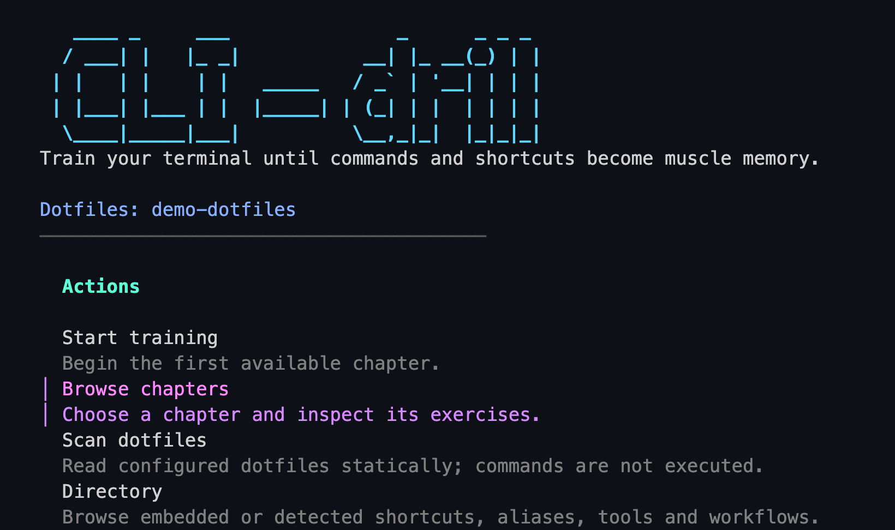

<div align="center">

# CLI-Drill

<!-- Keep this anchor without href to prevent GitHub image auto-linking. -->
<a name="cli-drill-hero">
  
</a>

**Make your terminal second nature.**

A terminal trainer for your shortcuts and ZSH dotfiles.

[](PROJECT_STATE.md)
[](go.mod)
[](docs/SPEC.md)

**[English](#english)** &nbsp; / &nbsp; **[Français](#français)**

[Install](#installation) · [First drill](#quick-start) &nbsp; / &nbsp;
[Installer](#installer-cli-drill) · [Premier exercice](#demarrage-rapide)

<sub>Live TUI · demo dotfiles · cropped /
TUI réelle · dotfiles de démonstration · recadrée</sub>

</div>

---

## English

A terminal training app that turns shell knowledge into practice. Start with
**10 built-in chapters and 68 exercises**, then build editable lessons from
your own ZSH dotfiles. Browse, practise and review without leaving the terminal.

> **Work in progress.** A usable CLI/TUI MVP, still evolving. Menus mix English
> and French; bundled lessons and feedback are currently in French.

[Install](#installation) · [Quick start](#quick-start) ·
[Examples](#examples) ·
[Your dotfiles](#train-with-your-dotfiles) · [Development](#development)

<a name="why-cli-drill"></a>

### `01` / Why CLI-Drill?

A dotfiles repository records how your shell works. Remembering what you put
in it is another skill entirely. That alias you wrote last month, the shortcut
you keep looking up, the right tool for a familiar task: CLI-Drill gives you
a place to rehearse them.

It began with a personal ZSH setup and a simple goal: learn your own environment
through short, practical exercises. It is built for developers and terminal
enthusiasts revisiting their tools, learning an unfamiliar setup, or turning
their dotfiles documentation into something they can practise.

**Start with the included lessons. Make the next ones your own.**

<a name="features"></a>

### `02` / Features

- **Practise actual keystrokes.** Press shortcuts such as `Ctrl+A`, get immediate
  feedback and revisit missed shortcuts in a dedicated key capture mode.
- **Learn in short chapters.** Navigation, ZSH aliases and functions, everyday
  tools, search, file previews, Micro, Glow and dotfiles workflows.
- **Choose your interface.** Browse the Bubble Tea TUI or jump straight into a
  chapter from the CLI.
- **Look up what you know.** Filter and search a typed directory of shortcuts,
  aliases, functions, tools and other learning entries.
- **Create lessons from your setup.** Statically scan configured ZSH and Markdown
  files, then generate YAML chapters you can read and edit.
- **Keep progress local.** Correct answers and chapter attempts are saved as JSON.
  Training needs no account, telemetry or runtime network access.

Exercise formats include free answers, multiple choice, scenarios, command-text
simulation and real shortcut capture. The simulator **compares text; it never
executes your answer**. Tools mentioned in lessons need not be installed to practise.

---

<a name="installation"></a>

### `03` / Installation

You need [Go 1.23 or newer](https://go.dev/doc/install), Git and an interactive
terminal for the TUI and shortcut capture. These commands use a Unix shell on
macOS or Linux. ZSH is the only supported **dotfiles input format**; CLI-Drill
does not source your shell configuration.

```sh
git clone https://github.com/benabot/cli-drill.git
cd cli-drill
go install ./cmd/cli-drill
```

Go installs the executable into `GOBIN` if set, otherwise into `GOPATH/bin`.
If `cli-drill` is not found, add that directory to this terminal’s `PATH`:

```sh
cli_drill_bin="$(go env GOBIN)"
if [ -z "$cli_drill_bin" ]; then
  cli_drill_bin="$(go env GOPATH)/bin"
fi
export PATH="$cli_drill_bin:$PATH"
```

This affects the current session only; see the [Go installation reference](https://pkg.go.dev/cmd/go#hdr-Compile_and_install_packages_and_dependencies).
Verify the install, then open the app:

```sh
cli-drill --help
cli-drill
```

**No configuration is needed for the built-in lessons.** The first build may
download Go dependencies; the app itself works offline. Prebuilt releases and
a Homebrew tap are still on the roadmap.

<a name="quick-start"></a>

### `04` / Quick Start

**Home** → **Browse chapters** → **Raccourcis terminal** →
<kbd>Ctrl</kbd> + <kbd>A</kbd>

1. Run `cli-drill`. Select **Browse chapters** with `j`/`k` or the arrow keys,
   then press `Enter`.
2. Choose **Raccourcis terminal**, open its detail screen with `Enter`, then
   press `Enter` again to start key training.
3. The first prompt asks you to go to the beginning of the line. **Press
   `Ctrl+A`**; do not type its name. You should see `Recu: Ctrl+A` and `Correct.`
4. Press `Enter` for the next exercise. Review missed shortcuts at the end if
   offered. Leaving this dedicated mode returns you to the TUI Home screen.

Prefer a direct command? Start the same chapter with:

```sh
cli-drill train 01-raccourcis-terminal
```

In key training, `h` toggles help and `Esc` or `Ctrl+C` exits. After a wrong
answer, `r` retries and `s` reveals the solution. In TUI text exercises, type an
answer and press `Enter`; `Esc` returns to the chapter and `Ctrl+C` quits.

---

<a name="terminal-preview"></a>

### `05` / Terminal Preview

The hero captures the live Home menu with **Browse chapters** selected.
Opening the first chapter shows its exercise count, progress and launch action.

<details>
<summary>Browse → inspect → start: the chapter detail screen</summary>

Fresh progress, before starting the first drill; outer padding omitted.

```text
Raccourcis terminal
Memoriser les raccourcis de navigation et edition de ligne.
────────────────────────────────────────

Chapter: 01-raccourcis-terminal
Exercises: 8
Progress: 0/8 completed
Score: 0/0 correct

Ce chapitre entraîne les vrais raccourcis clavier.
cli-drill ouvre un mode dédié pour capturer les touches.

enter start key training · esc chapters · g home · h help · q quit
```

</details>

**Press the shortcut. Get feedback. Keep going.**

Actual text from the first shortcut drill, with colour and redraw sequences
removed. These are two successive screens, not a screenshot.

```text
Raccourcis terminal
Progression: 1/8

Appuie sur le raccourci pour aller au debut de la ligne.

Waiting for key...

────────────────────────────────────────
h help · Esc quit
```

Press `Ctrl+A`:

```text
Recu: Ctrl+A
Correct.
Ctrl+A place le curseur au debut de la ligne.

────────────────────────────────────────
Enter next · Esc quit
```

<a name="examples"></a>

### `06` / Examples

These examples use the bundled chapters. Custom chapters or a scan configuration
can change the available entries. Outputs retain the app’s original language.

#### Rehearse a navigation workflow

```sh
cli-drill train 02-navigation-shell
```

Start by answering `zoxide` to the scenario about returning to a previously
visited directory. Its sixth exercise asks for a pipeline. An interactive
session ends like this; the `>` line includes your typed answer:

```text
6/6 Trouver des dossiers puis en choisir un avec fzf.
> fd -t d | fzf
Correct.
Le shell simule compare la reponse sans executer la commande.
```

Neither `fd` nor `fzf` is launched. You are practising command recall.

#### Find a shortcut without starting a lesson

```sh
cli-drill search ctrl-a
cli-drill show ctrl-a
```

On an unconfigured install, `show` prints this detail and a notice that it is
using embedded chapters:

```text
id: ctrl-a
name: Ctrl+A
type: shortcut
summary: Appuie sur le raccourci pour aller au debut de la ligne.
tags: 01-raccourcis-terminal, key-sequence
```

Use the exact entry ID returned by `search` when names are ambiguous.

#### Check your progress

```sh
cli-drill stats
```

After all six navigation answers are correct, starting with fresh progress:

```text
Completed exercises: 6
Chapters with attempts: 1
Streak: 0
```

Counts depend on your sessions. The current implementation does not update
`Streak`; completed exercises and chapter attempts are the useful counters.

<a name="train-with-your-dotfiles"></a>

### `07` / Train with your dotfiles

This optional path personalises the lessons. Preview the default configuration
without writing anything, then create it:

```sh
cli-drill init --print
cli-drill init
```

`init` prints the config path and refuses to overwrite an existing file by
default. Open that TOML file, set `dotfiles_path` to your repository and adjust
`[paths].aliases`, `[paths].functions` and `[paths].docs` to files inside it.
The scanner reads these explicit paths; it does not recursively discover or
source your shell setup. Keep the default security exclusions.

```sh
cli-drill scan --summary
cli-drill directory --type alias
cli-drill generate
cli-drill chapters
cli-drill train 03-alias-zsh
```

For a minimal repository whose configured alias file contains only
`alias cgs='git status --short'`, with empty function and documentation lists,
`directory --type alias` returns these tab-separated fields:

```text
alias   cgs   cgs   git status --short
```

<details>
<summary>See the scan summary for this one-alias example</summary>

With the same minimal configuration:

```sh
cli-drill scan --summary
```

```text
aliases: 1
functions: 0
tools: 0
concepts: 0
workflows: 0
chapters: 0
total: 1
```

</details>

The columns are `type`, `id`, `name` and `summary`. The alias is read as text,
never executed. Generated exercises ask you to recall the detected alias.

**Generation changes the active lessons.** `generate` writes ten YAML chapters
to the user chapters directory. Once that directory contains `*.yaml` files,
they replace the bundled set. Some may be empty, depending on your sources;
review the YAML and train a chapter containing exercises. To inspect an export
without activating it, use `cli-drill generate --out ./my-chapters`: a custom
output directory is not automatically loaded.

<details>
<summary>Storage paths and additional commands</summary>

| Data | macOS default | Linux default |
| --- | --- | --- |
| Config | `~/Library/Application Support/cli-drill/config.toml` | `~/.config/cli-drill/config.toml` |
| User chapters | `~/Library/Application Support/cli-drill/chapters/` | `~/.config/cli-drill/chapters/` |
| Progress | `~/.local/share/cli-drill/progress.json` | `~/.local/share/cli-drill/progress.json` |

Linux config paths follow `XDG_CONFIG_HOME` when set. Progress follows
`XDG_DATA_HOME` on both systems. `--config` selects a TOML file; `--progress`
selects a JSON file. `--config` does not relocate the user chapters directory.

```sh
cli-drill chapters                  # List IDs and exercise counts
cli-drill scan --type tool          # Show detected tools
cli-drill directory --type tool     # Filter the active CLI catalog
cli-drill search rg                 # Search the active CLI catalog
cli-drill show ctrl-a               # Inspect an exact entry
cli-drill generate --help           # Inspect generation options
```

`train` without an ID selects the first chapter. `init` and `generate` refuse
to overwrite existing files unless `--force` is supplied. `cli-drill reset --yes`
deletes the selected progress file.

</details>

---

<a name="how-it-works"></a>

### `08` / How it works

```text
Configured ZSH + Markdown
         │ static scan
         ▼
   Typed directory ───────► search / show
         │ generate
         ▼
Editable YAML chapters
         │ load
         ▼
 CLI / TUI training ──────► local JSON progress
         ▲
 Bundled chapters provide the first-run lessons
```

<details>
<summary>Under the hood: shared packages and catalog sources</summary>

Cobra wires the CLI; Bubble Tea, Bubbles and Lip Gloss provide the TUI. Shared
Go packages parse sources, deduplicate entries by type and ID, load YAML and
match answers against accepted variants. The ZSH parser detects alias definitions
and function names without evaluating shell code.

With a config present or `--config` supplied, CLI `directory`, `search` and
`show` use a fresh scan. Otherwise, they use the active chapters; `show` can
fall back to default dotfiles paths if an entry is missing. The TUI directory
uses loaded chapters. Its **Configuration** and **Scan dotfiles** screens give
read-only guidance; use the CLI to create config or scan files.

</details>

<a name="project-structure"></a>

### `09` / 📂 Project Structure

```text
cli-drill/
├── cmd/cli-drill/main.go   # Executable entry point
├── internal/
│   ├── app/               # CLI commands and training
│   ├── catalog/           # Typed entries, deduplication and search
│   ├── chapter/           # YAML loading and generation
│   ├── config/            # TOML configuration
│   ├── detect/            # Static scanner and path filtering
│   ├── exercise/          # Exercise types and answer matching
│   ├── markdown/          # Markdown extraction
│   ├── progress/          # JSON progress
│   ├── shell/zsh/         # Alias and function parsers
│   ├── tui/               # Terminal screens and navigation
│   └── xdg/               # Config and data paths
├── data/
│   ├── chapters/          # Ten default YAML chapters
│   └── defaults.go        # Embeds chapters in the binary
├── testdata/               # Directory for shared test fixtures
├── docs/                   # Specification, architecture and decisions
├── go.mod                  # Go version and dependencies
├── go.sum                  # Dependency checksums
├── AGENTS.md               # Repository working instructions
├── PROJECT_STATE.md        # Current implementation status
├── TODO.md                 # Backlog
└── README.md               # You are here
```

---

<a name="development"></a>

### `10` / Development

From the repository root:

```sh
go run ./cmd/cli-drill --help
go run ./cmd/cli-drill
go test ./...
```

Tests cover parsers, answer matching, chapter/config loading, scanner filtering,
catalog deduplication, progress and CLI/TUI behaviour. To contribute, open an
[issue](https://github.com/benabot/cli-drill/issues) describing the problem or
idea, keep changes focused and include relevant validation. Preserve the local,
static approach and editable chapters.

Read the [specification](docs/SPEC.md), [architecture](docs/ARCHITECTURE.md),
[decisions](docs/DECISIONS.md), [current state](PROJECT_STATE.md) and
[working instructions](AGENTS.md) before a substantial change. Technical
project documentation currently mixes French and English.

<a name="roadmap-license-author"></a>

### `11` / Roadmap, license & author

The [backlog](TODO.md) includes lesson refinement through real use, randomised
sessions, TUI preferences, releases and a Homebrew tap. Bash and Fish support
are deferred. These are plans, not available features.

**License:** no license file is currently included in the repository.

Created by [benabot](https://github.com/benabot).

[Continue in French ↓](#français) · [Back to top ↑](#cli-drill)

---

## Français

Une application pour apprendre son terminal par la pratique. Commencez avec
**10 chapitres et 68 exercices intégrés**, puis créez vos leçons à partir de
vos dotfiles ZSH. Explorez, entraînez-vous et révisez depuis le terminal.

> **Projet en cours.** Un MVP CLI/TUI utilisable, en évolution. Les menus mêlent
> anglais et français ; les leçons et corrections intégrées sont en français.

[Installation](#installer-cli-drill) · [Démarrage](#demarrage-rapide) ·
[Exemples](#exemples-pratiques) ·
[Vos dotfiles](#apprendre-avec-vos-dotfiles) · [Développement](#developper-et-contribuer)

<a name="pourquoi-cli-drill"></a>

### `01` / Pourquoi CLI-Drill ?

Vos dotfiles décrivent votre environnement. Encore faut-il se souvenir de ce
qu’on y a ajouté : un alias écrit le mois dernier, un raccourci qu’on recherche
trop souvent, l’outil adapté à une tâche courante. CLI-Drill vous propose de
les réviser par la pratique.

Le projet est né d’un environnement ZSH personnel, avec une idée simple :
apprendre ses propres outils grâce à des exercices courts. Il s’adresse aux
développeurs et aux utilisateurs du terminal qui reprennent leurs habitudes,
découvrent une configuration ou veulent transformer leur documentation de
dotfiles en support d’entraînement.

**Commencez avec les leçons intégrées. Construisez ensuite les vôtres.**

<a name="fonctionnalites"></a>

### `02` / Fonctionnalités

- **Pratiquer les vraies touches.** Appuyez sur des raccourcis comme `Ctrl+A`,
  obtenez une correction immédiate et révisez vos erreurs dans un mode dédié.
- **Apprendre par chapitres courts.** Navigation, alias et fonctions ZSH, outils
  quotidiens, recherche, lecture de fichiers, Micro, Glow et workflows dotfiles.
- **Choisir votre interface.** Parcourez la TUI Bubble Tea ou lancez directement
  un chapitre depuis la CLI.
- **Retrouver une commande.** Filtrez et interrogez un annuaire typé de
  raccourcis, d’alias, de fonctions, d’outils et d’autres entrées pédagogiques.
- **Créer vos leçons.** Analysez vos fichiers ZSH et Markdown configurés, puis
  générez des chapitres YAML lisibles et modifiables.
- **Garder votre progression en local.** Réponses correctes et tentatives par
  chapitre sont enregistrées en JSON. L’entraînement fonctionne sans compte,
  télémétrie ni accès réseau à l’exécution.

Les exercices comprennent réponses libres, choix multiples, mises en situation,
simulation de commandes et capture de raccourcis. Le simulateur **compare le
texte saisi sans jamais l’exécuter**. Les outils cités n’ont pas besoin d’être
installés pour s’entraîner.

---

<a name="installer-cli-drill"></a>

### `03` / Installation

Prévoyez [Go 1.23 ou plus récent](https://go.dev/doc/install), Git et un terminal
interactif pour la TUI et la capture des raccourcis. Ces commandes utilisent un
shell Unix sur macOS ou Linux. ZSH est le seul **format de dotfiles pris en
charge** ; CLI-Drill ne charge pas votre configuration dans un shell.

```sh
git clone https://github.com/benabot/cli-drill.git
cd cli-drill
go install ./cmd/cli-drill
```

Go installe le binaire dans `GOBIN` si cette variable est définie, sinon dans
`GOPATH/bin`. Si `cli-drill` est introuvable, ajoutez ce dossier au `PATH` :

```sh
cli_drill_bin="$(go env GOBIN)"
if [ -z "$cli_drill_bin" ]; then
  cli_drill_bin="$(go env GOPATH)/bin"
fi
export PATH="$cli_drill_bin:$PATH"
```

Ce réglage concerne la session courante ; la [documentation Go](https://pkg.go.dev/cmd/go#hdr-Compile_and_install_packages_and_dependencies)
précise les emplacements. Vérifiez l’installation, puis ouvrez l’application :

```sh
cli-drill --help
cli-drill
```

**Aucune configuration n’est nécessaire pour les leçons intégrées.** La première
compilation peut télécharger les dépendances Go ; l’application fonctionne
ensuite hors ligne. Les binaires prêts à télécharger et le tap Homebrew sont
prévus pour plus tard.

<a name="demarrage-rapide"></a>

### `04` / Démarrage rapide

**Accueil** → **Browse chapters** → **Raccourcis terminal** →
<kbd>Ctrl</kbd> + <kbd>A</kbd>

1. Lancez `cli-drill`. Sélectionnez **Browse chapters** avec `j`/`k` ou les
   flèches, puis validez avec `Entrée`.
2. Choisissez **Raccourcis terminal**, ouvrez sa fiche avec `Entrée`, puis
   appuyez de nouveau sur `Entrée` pour démarrer l’entraînement aux touches.
3. Le premier exercice demande de revenir au début de la ligne. **Appuyez sur
   `Ctrl+A`**, sans écrire son nom. L’application affiche `Recu: Ctrl+A`,
   puis `Correct.`
4. Appuyez sur `Entrée` pour continuer. Révisez les raccourcis manqués à la fin
   si l’option est proposée. Quitter ce mode vous ramène à l’accueil TUI.

Pour lancer directement le même chapitre :

```sh
cli-drill train 01-raccourcis-terminal
```

Dans ce mode, `h` affiche ou masque l’aide ; `Échap` ou `Ctrl+C` quitte la
session. Après une erreur, `r` permet de réessayer et `s` affiche la solution.
Dans les exercices textuels TUI, saisissez une réponse et validez
avec `Entrée` ;
`Échap` revient au chapitre et `Ctrl+C` quitte l’application.

---

<a name="apercu-du-terminal"></a>

### `05` / Aperçu du terminal

Le hero montre le véritable menu d’accueil, avec **Browse chapters** sélectionné.
Ouvrir le premier chapitre affiche son nombre d’exercices, la progression et
l’action permettant de démarrer.

<details>
<summary>Parcourir → consulter → démarrer : la fiche du chapitre</summary>

Progression initialement vide, avant le premier exercice ; marges retirées.

```text
Raccourcis terminal
Memoriser les raccourcis de navigation et edition de ligne.
────────────────────────────────────────

Chapter: 01-raccourcis-terminal
Exercises: 8
Progress: 0/8 completed
Score: 0/0 correct

Ce chapitre entraîne les vrais raccourcis clavier.
cli-drill ouvre un mode dédié pour capturer les touches.

enter start key training · esc chapters · g home · h help · q quit
```

</details>

**Appuyez sur le raccourci. Voyez la correction. Continuez.**

Texte réel du premier exercice, sans couleurs ni séquences de rafraîchissement.
Voici deux écrans successifs, sous forme textuelle :

```text
Raccourcis terminal
Progression: 1/8

Appuie sur le raccourci pour aller au debut de la ligne.

Waiting for key...

────────────────────────────────────────
h help · Esc quit
```

Après un appui sur `Ctrl+A` :

```text
Recu: Ctrl+A
Correct.
Ctrl+A place le curseur au debut de la ligne.

────────────────────────────────────────
Enter next · Esc quit
```

<a name="exemples-pratiques"></a>

### `06` / Exemples pratiques

Ces exemples utilisent les chapitres intégrés. Des chapitres personnels ou une
configuration de scan peuvent changer les entrées disponibles. Les sorties
conservent les libellés de l’application.

#### Réviser un workflow de navigation

```sh
cli-drill train 02-navigation-shell
```

Répondez d’abord `zoxide` à la mise en situation sur le retour dans un dossier
déjà visité. Le sixième exercice demande un pipeline. Voici la fin d’une
session interactive ; la ligne `>` contient votre saisie :

```text
6/6 Trouver des dossiers puis en choisir un avec fzf.
> fd -t d | fzf
Correct.
Le shell simule compare la reponse sans executer la commande.
```

Ni `fd` ni `fzf` ne sont lancés. Vous vous entraînez à retrouver la commande.

#### Retrouver un raccourci sans lancer une leçon

```sh
cli-drill search ctrl-a
cli-drill show ctrl-a
```

Sans configuration, `show` affiche ce détail et un message indiquant
l’utilisation des chapitres embarqués :

```text
id: ctrl-a
name: Ctrl+A
type: shortcut
summary: Appuie sur le raccourci pour aller au debut de la ligne.
tags: 01-raccourcis-terminal, key-sequence
```

Utilisez l’identifiant exact renvoyé par `search` si le nom est ambigu.

#### Consulter sa progression

```sh
cli-drill stats
```

Après les six bonnes réponses du chapitre de navigation, avec une progression
initialement vide :

```text
Completed exercises: 6
Chapters with attempts: 1
Streak: 0
```

Les résultats dépendent de vos sessions. L’implémentation actuelle ne met pas
à jour `Streak` ; les compteurs utiles concernent les exercices réussis et
les chapitres tentés.

<a name="apprendre-avec-vos-dotfiles"></a>

### `07` / Apprendre avec vos dotfiles

Ce parcours facultatif personnalise les leçons. Prévisualisez la configuration
par défaut sans écrire de fichier, puis créez-la :

```sh
cli-drill init --print
cli-drill init
```

`init` affiche le chemin créé et refuse par défaut d’écraser un fichier existant.
Ouvrez ce fichier TOML, renseignez `dotfiles_path` et adaptez `[paths].aliases`,
`[paths].functions` et `[paths].docs` aux fichiers de votre dépôt. Le scanner
lit ces chemins explicites : il ne découvre pas récursivement votre configuration
shell et ne l’exécute pas. Conservez les exclusions de sécurité par défaut.

```sh
cli-drill scan --summary
cli-drill directory --type alias
cli-drill generate
cli-drill chapters
cli-drill train 03-alias-zsh
```

Pour un dépôt minimal dont le fichier d’alias configuré contient uniquement
`alias cgs='git status --short'`, avec des listes de fonctions et de documentation
vides, `directory --type alias` renvoie ces champs séparés par des tabulations :

```text
alias   cgs   cgs   git status --short
```

<details>
<summary>Voir le résumé du scan pour cet exemple à un alias</summary>

Avec la même configuration minimale :

```sh
cli-drill scan --summary
```

```text
aliases: 1
functions: 0
tools: 0
concepts: 0
workflows: 0
chapters: 0
total: 1
```

</details>

Les colonnes sont `type`, `id`, `name` et `summary`. L’alias est lu comme du texte,
sans être exécuté. Les exercices générés demandent de retrouver l’alias détecté.

**La génération change les leçons actives.** `generate` écrit dix chapitres YAML
dans le dossier utilisateur. Dès que ce dossier contient des fichiers `*.yaml`,
ils remplacent les chapitres intégrés. Certains peuvent être vides selon vos
sources : relisez le YAML et choisissez un chapitre contenant des exercices.
Pour examiner un export sans l’activer, utilisez
`cli-drill generate --out ./my-chapters` : ce dossier n’est pas chargé automatiquement.

<details>
<summary>Emplacements et commandes complémentaires</summary>

| Donnée | Emplacement macOS par défaut | Emplacement Linux par défaut |
| --- | --- | --- |
| Configuration | `~/Library/Application Support/cli-drill/config.toml` | `~/.config/cli-drill/config.toml` |
| Chapitres utilisateur | `~/Library/Application Support/cli-drill/chapters/` | `~/.config/cli-drill/chapters/` |
| Progression | `~/.local/share/cli-drill/progress.json` | `~/.local/share/cli-drill/progress.json` |

Sous Linux, la configuration suit `XDG_CONFIG_HOME` si elle est définie.
La progression suit `XDG_DATA_HOME` sur les deux systèmes. `--config` choisit
un TOML ; `--progress` choisit un JSON. `--config` ne déplace pas les chapitres.

```sh
cli-drill chapters                  # Lister les IDs et nombres d’exercices
cli-drill scan --type tool          # Voir les outils détectés
cli-drill directory --type tool     # Filtrer le catalogue actif de la CLI
cli-drill search rg                 # Chercher dans le catalogue actif
cli-drill show ctrl-a               # Consulter une entrée exacte
cli-drill generate --help           # Voir les options de génération
```

Sans identifiant, `train` sélectionne le premier chapitre. `init` et `generate`
refusent d’écraser les fichiers existants, sauf avec `--force`.
`cli-drill reset --yes` supprime le fichier de progression sélectionné.

</details>

---

<a name="fonctionnement"></a>

### `08` / Fonctionnement

```text
Fichiers ZSH + Markdown configurés
         │ analyse statique
         ▼
   Annuaire typé ──────────► search / show
         │ generate
         ▼
Chapitres YAML modifiables
         │ chargement
         ▼
 Entraînement CLI / TUI ───► progression JSON locale
         ▲
 Chapitres intégrés pour le premier lancement
```

<details>
<summary>Sous le capot : packages partagés et sources du catalogue</summary>

Cobra organise la CLI ; Bubble Tea, Bubbles et Lip Gloss composent la TUI.
Les packages Go partagés analysent les sources, dédupliquent les entrées par
type et identifiant, chargent le YAML et comparent les réponses aux variantes
acceptées. Le parseur ZSH détecte les définitions d’alias et les noms de
fonctions sans évaluer le code shell.

Avec une configuration présente ou l’option `--config`, les commandes CLI
`directory`, `search` et `show` utilisent un nouveau scan. Sinon, elles lisent
les chapitres actifs ; `show` peut consulter les chemins dotfiles par défaut
si une entrée manque. L’annuaire TUI utilise les chapitres chargés. Ses écrans
**Configuration** et **Scan dotfiles** fournissent des indications en lecture
seule : utilisez la CLI pour créer la configuration ou scanner les fichiers.

</details>

<a name="structure-du-projet"></a>

### `09` / 📂 Structure du projet

```text
cli-drill/
├── cmd/cli-drill/main.go   # Point d’entrée du binaire
├── internal/
│   ├── app/               # Commandes CLI et entraînement
│   ├── catalog/           # Entrées typées, déduplication et recherche
│   ├── chapter/           # Chargement et génération YAML
│   ├── config/            # Configuration TOML
│   ├── detect/            # Analyse statique et filtrage des chemins
│   ├── exercise/          # Types d’exercices et correction des réponses
│   ├── markdown/          # Extraction Markdown
│   ├── progress/          # Progression JSON
│   ├── shell/zsh/         # Parseurs d’alias et de fonctions
│   ├── tui/               # Écrans et navigation
│   └── xdg/               # Chemins de configuration et de données
├── data/
│   ├── chapters/          # Dix chapitres YAML par défaut
│   └── defaults.go        # Embarquement des chapitres dans le binaire
├── testdata/               # Dossier prévu pour les fixtures partagées
├── docs/                   # Spécification, architecture et décisions
├── go.mod                  # Version Go et dépendances
├── go.sum                  # Sommes de contrôle des dépendances
├── AGENTS.md               # Consignes de travail du dépôt
├── PROJECT_STATE.md        # État de l’implémentation
├── TODO.md                 # Backlog
└── README.md               # Vous êtes ici
```

---

<a name="developper-et-contribuer"></a>

### `10` / Développer et contribuer

Depuis la racine du dépôt :

```sh
go run ./cmd/cli-drill --help
go run ./cmd/cli-drill
go test ./...
```

Les tests couvrent les parseurs, la correction des réponses, les formats de
chapitres et de configuration, le filtrage du scan, la déduplication, la
progression et les comportements CLI/TUI. Pour contribuer, ouvrez une
[issue](https://github.com/benabot/cli-drill/issues) décrivant le problème ou
l’idée, proposez un changement ciblé et indiquez les validations effectuées.
Préservez l’approche locale, statique et les chapitres modifiables.

Avant un changement conséquent, consultez la [spécification](docs/SPEC.md),
l’[architecture](docs/ARCHITECTURE.md), les [décisions](docs/DECISIONS.md),
l’[état courant](PROJECT_STATE.md) et les [consignes du dépôt](AGENTS.md).
La documentation technique du projet est actuellement en français et en anglais.

<a name="feuille-de-route-licence-et-auteur"></a>

### `11` / Feuille de route, licence et auteur

Le [backlog](TODO.md) prévoit d’affiner les leçons à l’usage, d’explorer des
sessions aléatoires, d’améliorer les préférences TUI et de préparer les releases
et un tap Homebrew. La prise en charge de Bash et Fish est différée.
Ces évolutions sont envisagées, pas encore disponibles.

**Licence :** aucun fichier de licence n’est actuellement inclus dans le dépôt.

Créé par [benabot](https://github.com/benabot).

[Read in English ↑](#english) · [Retour en haut ↑](#cli-drill)

---

<div align="center">

**CLI-Drill** · Learn your tools. Make them yours.

Apprenez vos outils. Prenez vos habitudes.

[Source](https://github.com/benabot/cli-drill) ·
[Issues](https://github.com/benabot/cli-drill/issues)

</div>
